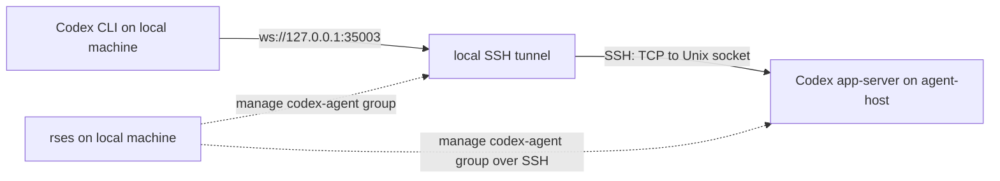

# rses

[中文说明](README.zh-CN.md)

`rses` (remote sessions) is a session-based service management and forwarding tool. It puts development services, Coding Agents, and port forwards spread across your workstation and remote hosts into one dependency-aware configuration, then lets you start, stop, inspect, and access them entirely from your local machine.

Developers often run HTTP backends, databases, or Coding Agents such as Codex, OpenCode, and Hermes across several local and cloud hosts. These services should usually listen only on loopback or a Unix socket, but reaching and managing them then requires separate login, tmux, and forwarding commands for every host.

In rses, each service, Agent, or tunnel is a session. rses manages its command, execution host, dependencies, and lifecycle, and can connect remote interfaces back to your workstation through SSH or another Provider. A common setup starts an Agent service on a remote loopback address or Unix socket, then starts a local SSH forward so a local client can reach it.



Once configured, start and watch the complete `codex-agent` group locally:

```bash
rses start --remote --group codex-agent
```

Connect through the local port:

```bash
codex --remote ws://127.0.0.1:35003
```

Stop the complete group when it is no longer needed:

```bash
rses stop --remote --group codex-agent
```

The group contains a remote Codex app-server and a local SSH tunnel. Dependencies make rses start the app-server before the tunnel and clean them up in the opposite lifecycle order. Starting a group also opens the watch view by default.

The app-server listens only on a remote Unix socket and the tunnel binds only to local `127.0.0.1`, so no public service port is required. The remote host needs SSH, tmux, `/bin/sh`, and the service runtime, but it does not need rses itself.

The same model scales to multiple Agents, remote hosts, and local sessions. Groups describe sets of sessions operated together, tags provide role-based selection, and watch collects the selected status and logs in one interface.

rses targets personal and small-team development environments. It is not a deployment platform and does not replace systemd, Kubernetes, or production monitoring.

## Capabilities

- **Manage services and Agents together:** local commands run in local tmux; remote commands run through SSH in remote tmux; both use the same CLI.
- **Access cloud services locally:** manage SSH forwarding, Cloudflare Access, and other tunnels alongside the services they expose.
- **Operate complete session groups:** use groups for selection and dependencies for start and stop ordering.
- **Inspect status and logs centrally:** query errors and recent logs or keep watching without logging into every host.
- **Limit every operation:** select by name, group, tag, and remote host; watch only touches its initial filtered set.
- **Keep generated work inspectable:** `rses explain` shows scripts, paths, tmux targets, and attach commands.

## Requirements

Prebuilt releases support Linux and macOS on amd64 and arm64. Native Windows is not supported; WSL can be used as a Linux environment.

The local machine requires:

- `tmux`
- `/bin/sh`

Managing remote sessions also requires the system `ssh` client, while each remote host requires `tmux` and `/bin/sh`. SSH aliases and authentication should already work directly:

```bash
ssh your-host true
ssh your-host tmux -V
```

rses itself does not require a Provider. Individual Providers have their own dependencies, such as Python 3 or cloudflared. Building from source requires Go 1.25.10 or newer.

## Installation

### Release archive

Download the archive for your platform and `checksums.txt` from [GitHub Releases](https://github.com/bnkrr/rses/releases). For Linux amd64:

```bash
sha256sum --check --ignore-missing checksums.txt
tar -xzf rses_0.1.0_linux_amd64.tar.gz
mkdir -p ~/.local/bin
install -m 0755 rses_0.1.0_linux_amd64/rses ~/.local/bin/rses
rses version
```

On macOS, compare the archive with `checksums.txt` using `shasum -a 256`. macOS releases are currently not code-signed or notarized; environments that require a signed executable should build from source.

After installing the binary, initialize the user configuration directory:

```bash
rses init
```

Without an argument, `init` always targets the user configuration directory, normally `~/.config/rses`, or `$XDG_CONFIG_HOME/rses` when `XDG_CONFIG_HOME` is set. It writes an empty `rses.yaml` and extracts the official Providers embedded in the binary:

```text
~/.config/rses/
  rses.yaml
  providers/
    ssh-tunnel/
    cloudflared-tcp/
```

`init` refuses to overwrite an existing `rses.yaml` or `providers/` directory. To create a project configuration, pass the directory explicitly, for example `rses init .`; the default target never changes with the current working directory.

### Go install

```bash
go install github.com/bnkrr/rses/cmd/rses@latest
```

The installed binary contains the same initial configuration and official Providers, so it can also run `rses init` directly.

## Verify the installation

Create a local `rses.yaml` containing one session:

```yaml
sessions:
  clock:
    backend: tmux
    summary: print the current time every second
    command:
      argv: ["sh", "-lc", "while true; do date; sleep 1; done"]
```

```bash
rses start clock
rses status clock
rses logs --follow clock
```

Leaving the log view does not stop the session:

```bash
rses stop clock
```

`command.argv` is a structured argument array and does not receive implicit shell parsing. Use `sh -lc` explicitly only when a command needs loops, pipes, or variable expansion.

## Example: access a remote Codex locally

Assume Codex is installed on the cloud host `agent-host`. You want to use a local Codex CLI without exposing the app-server on a public interface. Put two sessions in a `codex-agent` group:

- `codex-app-server` starts the Codex app-server in remote tmux through SSH and listens only on a remote Unix socket.
- `codex-tunnel` runs locally and forwards `127.0.0.1:35003` to that remote socket.

### Configure the service and tunnel

```yaml
groups:
  codex-agent:
    sessions:
      codex-app-server:
        backend: ssh-tmux
        host: agent-host
        tags: [agent, codex, remote]
        summary: Codex app-server on agent-host
        command:
          argv:
            - /home/agent/.local/bin/codex
            - app-server
            - --listen
            - unix:///home/agent/.local/state/rses/codex-app-server.sock

      codex-tunnel:
        backend: tmux
        tags: [agent, codex, tunnel]
        summary: local Codex CLI -> agent-host app-server
        depends_on: [codex-app-server]
        stop_dependencies: [codex-app-server]
        command:
          argv:
            - ssh
            - -N
            - -o
            - ExitOnForwardFailure=yes
            - -o
            - BatchMode=yes
            - -L
            - 127.0.0.1:35003:/home/agent/.local/state/rses/codex-app-server.sock
            - agent-host
```

Sessions under `groups.codex-agent.sessions` automatically receive `group: codex-agent`. Adjust the remote user, Codex path, and socket path for your environment. `codex-tunnel` is an ordinary local session that runs the system SSH command, so it does not need a Provider. The `agent-host` SSH alias must already connect directly.

To configure forwarding modes with structured parameters, validation, keepalives, and reconnect backoff, replace this command with the bundled [`ssh-tunnel` Provider](providers/ssh-tunnel/README.md).

### Start and use the group

```bash
rses explain --remote codex-app-server
rses explain codex-tunnel
rses start --remote --group codex-agent
```

`--group codex-agent` selects both sessions, while `--remote` permits the operation to include the remote app-server. Because `codex-tunnel` depends on `codex-app-server`, rses starts the remote service first and establishes the local forward afterward. Starting multiple sessions opens watch automatically. In another terminal, connect with the local client:

```bash
codex --remote ws://127.0.0.1:35003
```

The connection uses existing SSH authentication. Neither the remote app-server nor the local tunnel binds a public interface. rses manages the service and forwarding lifecycle, but the SSH host, keys, and remote host security remain the user's responsibility.

Read the remote service logs:

```bash
rses logs --remote codex-app-server
```

Stop both sessions:

```bash
rses stop --remote --group codex-agent
```

The configuration uses three separate relationships:

- `groups.codex-agent` selects and operates the app-server and tunnel as one set and assigns their group automatically.
- `depends_on: [codex-app-server]` starts the app-server before the tunnel, even when only `codex-tunnel` was selected.
- `stop_dependencies: [codex-app-server]` stops the app-server after the tunnel, even when only `codex-tunnel` was selected.

Remove `stop_dependencies` if the tunnel should stop without stopping the app-server. The same pattern applies to OpenCode, Hermes, or any other Agent that exposes a local socket or TCP interface.

## Manage multiple services and Agents

A configuration can include local frontends, remote workers, several Agents, development services, and tunnels. Use groups for sets operated together and tags for roles or properties:

```yaml
sessions:
  frontend:
    backend: tmux
    group: dev
    tags: [web, local]
    command:
      cwd: /home/me/src/frontend
      argv: ["npm", "run", "dev"]

  worker:
    backend: ssh-tmux
    host: worker-host
    group: dev
    tags: [worker, remote]
    command:
      cwd: /srv/example-worker
      argv: ["./run-worker"]
```

Names, groups, and tags can be combined:

```bash
rses list --remote --group dev
rses start --remote --group dev
rses status --remote --tag api --tag remote
rses stop --remote frontend worker
rses status --remote --host worker-host
```

Different selector types use AND semantics, and repeated `--tag` flags must all match. Remote sessions are excluded unless `--remote` is present. `--remote` means "include remote sessions," not "remote sessions only"; `--host` restricts only the remote portion of the result.

To avoid accidental bulk operations, `start` and `stop` require a name, group, tag, or explicit `--all`. Starting a group, tags, or multiple names enters watch by default; scripts can disable that behavior with `--no-watch`:

```bash
rses start --remote --group dev --no-watch
```

## Watch view

```bash
rses watch --remote --group dev
```

Watch only displays and operates on the sessions selected when it starts. It never touches sessions outside that filtered set.

| Key | Action |
| --- | --- |
| `j` / `k` or arrow keys | Move selection |
| `s` | Start the selected session |
| `x` | Stop the selected session |
| `r` | Force-refresh displayed local sessions and every displayed remote host |
| `q`, `Esc` | Quit |

Local status refreshes every second. When a remote session is selected, rses continues refreshing local status and queries the displayed sessions on that remote host in one host-batched request. The selected remote host refreshes every five seconds. Moving the selection triggers the required query immediately, and a small animation marks an in-flight query.

Each snapshot fetches recent logs only for the selected session, avoiding log transfer for every session on the same host. Pressing `r` force-refreshes all remote hosts represented in the current list.

## Providers

A Provider is an external program executed locally. It translates tool-specific parameters into a normal `command.argv`, allowing rses to manage the result like any other session. A Provider only generates the command; backend, dependencies, group, tags, and lifecycle remain controlled by `rses.yaml`.

The binary includes:

- [`ssh-tunnel`](providers/ssh-tunnel/README.md): system SSH local, remote, SOCKS, and Unix-socket forwarding with reconnect backoff.
- [`cloudflared-tcp`](providers/cloudflared-tcp/README.md): `cloudflared access tcp` forwarding from a Cloudflare Access service to a local port.

Providers are executable code. Install Providers only from trusted sources.

Each Provider README lists its requirements, complete parameters, behavior, and additional examples. Provider sessions continue to use the common backend, dependency, group, tag, and lifecycle fields.

## Command reference

| Command | Purpose |
| --- | --- |
| `rses list` | List configuration without querying runtime state |
| `rses explain NAME` | Show generated scripts, state paths, and attach commands |
| `rses start NAME` | Start a session and its `depends_on` graph |
| `rses stop NAME` | Stop a session and process `stop_dependencies` |
| `rses status` | Query configured and recorded session status |
| `rses logs NAME` | Read logs; local sessions support `--follow` |
| `rses watch` | Open the interactive status and log view |
| `rses version` | Print the installed version |

`list` and `explain` only read local configuration and never connect over SSH, even with `--remote`. Remote logs currently do not support `--follow`.

## Configuration reference

With the global `-C DIR` option, rses uses only `DIR/rses.yaml`. Without `-C`, it uses the first existing file in this order:

1. The file specified by `RSES_CONFIG`
2. `./rses.yaml` in the current directory
3. `$XDG_CONFIG_HOME/rses/rses.yaml`, normally `~/.config/rses/rses.yaml`
4. `~/.rses/rses.yaml`

rses does not search parent directories. Provider paths are relative to the selected configuration file, not the command's working directory. For example, `rses -C ~/.config/rses status` always uses the user configuration. A missing config in an explicit directory is an error and never falls back to another location.

Sessions can be declared directly under top-level `sessions` or grouped under `groups.<name>.sessions`:

```yaml
sessions:
  standalone:
    backend: tmux
    group: dev
    command:
      argv: ["standalone-server"]

groups:
  dev:
    sessions:
      api:
        backend: tmux
        command:
          argv: ["api-server"]
```

- A top-level session may set `group` manually.
- A grouped session inherits its parent group and must not set `group` explicitly.
- Session names are globally unique; duplicates across top-level sessions or any groups are rejected.
- Groups only organize and select sessions. `depends_on` and `stop_dependencies` still control ordering.

Normal sessions support these fields:

| Field | Required | Description |
| --- | --- | --- |
| `backend` | Yes | `tmux` or `ssh-tmux` |
| `host` | Remote only | System SSH host alias |
| `command.argv` | Yes | Non-empty argument array |
| `command.cwd` | No | Absolute working directory on the execution host |
| `command.env` | No | Environment variables passed to the command |
| `group` | No | Single group name |
| `tags` | No | Labels used for combined selection |
| `summary` | No | Description shown by list, status, and watch |
| `depends_on` | No | Sessions recursively started first |
| `stop_dependencies` | No | Sessions stopped after this session |
| `state_dir` | No | Absolute state-directory override |

A Provider session replaces `command` with `provider` and `with`, but must still specify `backend`. See [`rses.example.yaml`](rses.example.yaml) for complete examples.

### Query, operation, and SSH timeouts

Every runtime option is optional. Defaults are:

```yaml
runtime:
  query_timeout: 10s
  operation_timeout: 30s
  ssh:
    connect_timeout: 8s
    batch_mode: true
    extra_args: []
```

- `query_timeout` limits status, watch, and remote log queries.
- `operation_timeout` limits start and stop operations.
- `ssh.connect_timeout` limits SSH connection establishment.
- `ssh.batch_mode` disables password and interactive authentication for queries by default.
- `ssh.extra_args` adds arguments to `ssh-tmux` queries and operations.

Remote queries are non-interactive by default. Expired keys, ProxyCommand failures, or authentication errors are displayed instead of waiting for a password inside watch. Complete interactive authentication in a normal terminal first:

```bash
ssh -o BatchMode=yes -o NumberOfPasswordPrompts=0 your-host true
```

## Custom Providers

A custom Provider lives beside the selected configuration at `providers/<name>/provider.json`:

```json
{"command":["python3","provider.py"]}
```

The command runs with the Provider directory as its working directory and receives JSON on stdin:

```json
{
  "name": "api-tunnel",
  "provider": "ssh-tunnel",
  "root": "/path/to/config-directory",
  "with": {
    "host": "your-host",
    "mode": "local",
    "listen": "127.0.0.1:3000",
    "target": "127.0.0.1:3000"
  }
}
```

Stdout is the protocol channel and may contain only the generated command JSON:

```json
{"command":{"argv":["some-program","--flag","value"]}}
```

Write diagnostics to stderr. If a Provider fails or returns invalid output, rses labels and displays stdout and stderr separately. A Provider cannot override core fields such as backend, host, group, tags, or dependencies.

## Runtime model

The CLI starts a local control daemon on demand. The daemon coordinates operations and stores runtime records, while long-running sessions remain owned by local or remote tmux windows. Therefore:

- Closing the local terminal does not stop a session.
- Restarting or upgrading the rses daemon does not stop tmux windows.
- After a configuration is moved, rses can still query, read logs, and stop recorded sessions.

Local state defaults to `~/.local/state/rses`. Set `RSES_STATE_DIR` to override state storage and `RSES_RUNTIME_DIR` to override the daemon Unix-socket directory.

## Troubleshooting

### Configuration or command is unexpected

```bash
rses list --wide
rses explain --remote NAME
```

`explain` shows the final command, generated scripts, state directory, log path, and attach command.

### Provider not found

Verify that `providers/<provider>/provider.json` is beside the `rses.yaml` that was actually selected. A local `./rses.yaml` takes precedence over the user configuration.

### SSH query timeout or authentication failure

Test the same host alias outside rses. ProxyCommand, Cloudflare Access, and hardware-key authentication should also be completed in a normal terminal first. Error details appear in the status `error:` line or the watch message area.

### Daemon state is unexpected

```bash
rses daemon meta
rses daemon shutdown
```

`shutdown` stops only the control daemon, not tmux sessions. The next rses command starts a new daemon. Its log defaults to `~/.local/state/rses/daemon.log`.

## Development and license

```bash
go test ./...
go vet ./...
go test -tags=integration -timeout=2m ./integration/...
```

See [`CHANGELOG.md`](CHANGELOG.md) for release history and [`THIRD_PARTY_NOTICES`](THIRD_PARTY_NOTICES) for dependency attributions. rses is distributed under the [MIT License](LICENSE).
