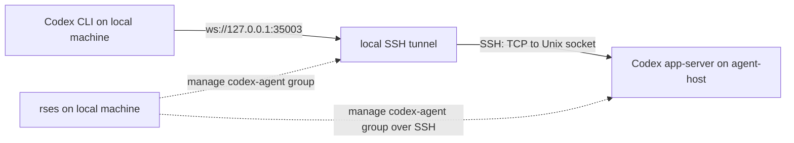

# rses

[English README](README.md)

`rses`（remote sessions）是一个基于 session 的服务管理与转发工具。它把散落在本机和多台远端主机上的开发服务、Coding Agent 以及端口转发按照依赖关系写进统一的配置，让你只在本机就能启动、停止、查看状态、读取日志和接入这些服务。

开发者可能同时把多个监听服务（如 HTTP 后端、数据库等）或 Coding Agent（如 Codex、OpenCode、Hermes 等）运行在不同的本地或云端主机上。从安全角度，这些服务通常只应当监听 loopback 或 Unix socket。同时，为了管理这些服务，开发者还需要登录不同的主机，这使得从本地接入这些服务非常麻烦。没有统一管理时，开发者需要维护多份脚本，逐台登录远端启动 tmux，再分别建立端口转发。

在 rses 中，每个服务、Agent 或 tunnel 都是一条 session。rses 管理它们的命令、运行位置、依赖和生命周期，并把需要的远端接口通过 SSH 或其他方式（我们称为 Provider）接到本地。最常见的场景是：在云端主机的 loopback 或 Unix socket 上启动 Agent 服务，同时在本机启动 SSH 转发，然后开发者就可以使用本地客户端接入了。



对使用者来说，所有操作都发生在本机。配置完成后，可在一个本地终端启动并观察整个 `codex-agent` 组：

```bash
rses start --remote --group codex-agent
```

启动成功后，即可通过本地端口接入远端 Codex：

```bash
codex --remote ws://127.0.0.1:35003
```

不再使用时，在本机停止整个组：

```bash
rses stop --remote --group codex-agent
```

`codex-agent` 组包含远端 Codex app-server 和本地 SSH tunnel。rses 会根据依赖关系先启动 app-server，再启动 tunnel；停止时按相反的生命周期关系执行清理。启动一组 session 后，rses 会自动进入 watch。

app-server 只监听远端 Unix socket，tunnel 只监听本机 `127.0.0.1`，不需要为它开放公网端口。远端只需要 SSH、tmux、`/bin/sh` 和服务自身的运行环境，不需要安装 rses。

同样的方式可以扩展到多个 Agent、多台远端主机和本地 session。group 用来表示需要共同启动和观察的一套 session，tag 用来按照角色或属性筛选，watch 界面则把筛选结果的状态和日志集中到一起。

rses 面向个人和小团队的开发环境，不是部署平台，也不取代 systemd、Kubernetes 或生产环境的进程监控系统。

## 主要能力

- **统一管理服务和 Agent**：本地命令运行在本机 tmux，远端命令通过 SSH 运行在远端 tmux，并使用同一组 CLI 操作。
- **从本地接入云端服务**：将 SSH forwarding、Cloudflare Access 等 tunnel 和服务一起管理，不必公开远端端口或每次手工建立 tunnel。
- **管理一整套 session**：使用 group 组织需要共同工作的服务和 tunnel，再通过依赖关系控制它们的启动和停止顺序。
- **集中查看状态和日志**：不用逐台登录远端，在本机查询错误、最近日志，或者使用 watch 持续观察。
- **只操作筛选出的 session**：按名称、group、tag 和远端 host 筛选，只管理当前项目或当前任务需要的部分。
- **保留可检查性**：`rses explain` 会显示生成的脚本、路径、tmux target 和 attach 命令。

## 系统要求

预编译版本支持 Linux 和 macOS 的 amd64、arm64。原生 Windows 暂不支持，可以在 WSL 中按 Linux 环境使用。

本机需要：

- `tmux`
- `/bin/sh`

管理远端 session 时还需要系统 `ssh` 客户端，远端主机需要 `tmux` 和 `/bin/sh`。SSH host alias 和认证应当已经可以直接使用：

```bash
ssh your-host true
ssh your-host tmux -V
```

rses不依赖Provider也能运行，Provider会有独立的依赖（python3、cloudflared等）。从源码构建需要 Go 1.25.10 或更新版本。

## 安装

### 从 Release 安装

从 [GitHub Releases](https://github.com/bnkrr/rses/releases) 下载对应系统的压缩包和 `checksums.txt`。例如 Linux amd64：

```bash
sha256sum --check --ignore-missing checksums.txt
tar -xzf rses_0.1.0_linux_amd64.tar.gz
mkdir -p ~/.local/bin
install -m 0755 rses_0.1.0_linux_amd64/rses ~/.local/bin/rses
rses version
```

macOS 可以用 `shasum -a 256` 对照 `checksums.txt`。macOS release 暂时没有代码签名和 notarization；要求签名程序的环境应从源码构建。

安装二进制后，初始化用户配置目录：

```bash
rses init
```

不带参数时，`init` 固定写入用户配置目录，通常是 `~/.config/rses`；如果设置了 `XDG_CONFIG_HOME`，则使用 `$XDG_CONFIG_HOME/rses`。它会生成一份空的 `rses.yaml`，并从二进制中释放官方 Provider：

```text
~/.config/rses/
  rses.yaml
  providers/
    ssh-tunnel/
    cloudflared-tcp/
```

已有 `rses.yaml` 或 `providers/` 时，`init` 会拒绝覆盖。需要项目级配置时必须显式指定目录，例如 `rses init .`；`rses init` 不会根据当前工作目录改变默认生成位置。

### 使用 Go 安装

```bash
go install github.com/bnkrr/rses/cmd/rses@latest
```

`go install` 得到的二进制同样内嵌初始配置和官方 Provider，可以直接运行 `rses init`。

## 验证安装

先用一个本地 session 确认 rses 和 tmux 工作正常。在当前目录创建 `rses.yaml`：

```yaml
sessions:
  clock:
    backend: tmux
    summary: print the current time every second
    command:
      argv: ["sh", "-lc", "while true; do date; sleep 1; done"]
```

```bash
rses start clock
rses status clock
rses logs --follow clock
```

退出日志不会停止 session：

```bash
rses stop clock
```

`command.argv` 是结构化参数，不经过隐式 shell 解析。只有需要循环、管道或变量展开时，才显式使用 `sh -lc`。

## 典型场景：从本地接入远端 Codex

假设 Codex 安装在云端的 `agent-host`，你希望在本地使用 Codex CLI，但不希望 app-server 监听公网接口。可以把远端服务和本地转发组成 `codex-agent` 组，其中包含两条 session：

- `codex-app-server`：通过 SSH 在 `agent-host` 的 tmux 中启动 Codex app-server，仅监听远端 Unix socket。
- `codex-tunnel`：在本机运行 SSH forwarding，把 `127.0.0.1:35003` 转发到这个远端 Unix socket。

### 配置服务和转发

```yaml
groups:
  codex-agent:
    sessions:
      codex-app-server:
        backend: ssh-tmux
        host: agent-host
        tags: [agent, codex, remote]
        summary: Codex app-server on agent-host
        command:
          argv:
            - /home/agent/.local/bin/codex
            - app-server
            - --listen
            - unix:///home/agent/.local/state/rses/codex-app-server.sock

      codex-tunnel:
        backend: tmux
        tags: [agent, codex, tunnel]
        summary: local Codex CLI -> agent-host app-server
        depends_on: [codex-app-server]
        stop_dependencies: [codex-app-server]
        command:
          argv:
            - ssh
            - -N
            - -o
            - ExitOnForwardFailure=yes
            - -o
            - BatchMode=yes
            - -L
            - 127.0.0.1:35003:/home/agent/.local/state/rses/codex-app-server.sock
            - agent-host
```

`groups.codex-agent.sessions` 下的 session 会自动获得 `group: codex-agent`，不需要逐条重复填写。示例中的用户名、Codex 路径和 socket 路径需要按远端环境调整。`codex-tunnel` 是一条普通本地 session，它直接运行系统 `ssh` 命令，因此不需要 Provider。SSH host alias `agent-host` 应当已经可以直接连接。

如果希望通过结构化参数配置不同的转发模式，并获得参数校验、默认保活和退避重连，可以把这条 `command` 替换为附带的 [`ssh-tunnel` Provider](providers/ssh-tunnel/README.md)。

### 启动和使用

```bash
rses explain --remote codex-app-server
rses explain codex-tunnel
rses start --remote --group codex-agent
```

`--group codex-agent` 会选中远端 app-server 和本地 tunnel，`--remote` 允许这次操作包含远端 session。因为 `codex-tunnel` 依赖 `codex-app-server`，rses 会先启动远端服务，成功后再建立本地转发。启动多条 session 后会自动进入 watch；可以在另一个终端使用本地 Codex CLI 接入：

```bash
codex --remote ws://127.0.0.1:35003
```

这条链路使用现有 SSH 认证，远端 app-server 不直接暴露 TCP 端口，本地 tunnel 也只绑定 loopback。rses 负责一起管理服务和转发，但 SSH host、密钥和远端主机本身的安全配置仍由使用者负责。

查看远端日志：

```bash
rses logs --remote codex-app-server
```

停止 tunnel 和 app-server：

```bash
rses stop --remote --group codex-agent
```

这里的依赖关系分别表示：

- `groups.codex-agent`：把 app-server 和 tunnel 作为同一套服务筛选和操作，并自动设置两条 session 的 group。
- `depends_on: [codex-app-server]`：启动 tunnel 前先启动 app-server；即使只启动 `codex-tunnel`，依赖也会被一并启动。
- `stop_dependencies: [codex-app-server]`：停止 tunnel 后再停止 app-server；即使只停止 `codex-tunnel`，依赖也会被一并停止。

如果只想停止 tunnel 而保留 app-server，可以删除 `stop_dependencies`，然后按名称停止 `codex-tunnel`。同样的模式也可以用于 OpenCode、Hermes 或其他提供本地 socket / TCP 接口的 Agent。

## 管理多个服务和 Agent

同一份配置可以继续加入本地前端、worker、多个远端 Agent、开发服务和其他 tunnel。group 适合表示一套需要共同操作的 session，tag 适合表达角色或属性：

```yaml
sessions:
  frontend:
    backend: tmux
    group: dev
    tags: [web, local]
    command:
      cwd: /home/me/src/frontend
      argv: ["npm", "run", "dev"]

  worker:
    backend: ssh-tmux
    host: worker-host
    group: dev
    tags: [worker, remote]
    command:
      cwd: /srv/example-worker
      argv: ["./run-worker"]
```

名称、group 和 tag 可以组合使用：

```bash
rses list --remote --group dev
rses start --remote --group dev
rses status --remote --tag api --tag remote
rses stop --remote frontend worker
rses status --remote --host worker-host
```

不同类型的筛选条件是 AND 关系，多个 `--tag` 也要求全部匹配。远端 session 默认不会被选中，必须显式添加 `--remote`。`--remote` 表示“包含远端”，不是“仅远端”；`--host` 只限制结果中的远端部分。

为避免误操作，`start` 和 `stop` 必须提供名称、group、tag 或显式的 `--all`。对 group、tag 或多个名称执行 `start` 后，rses 默认进入 watch；脚本中可以使用 `--no-watch`：

```bash
rses start --remote --group dev --no-watch
```

## Watch 界面

```bash
rses watch --remote --group dev
```

Watch 只显示并操作启动时筛选出的 session，不会触碰未筛选出来的项目。

| 按键 | 操作 |
| --- | --- |
| `j` / `k` 或方向键 | 移动选择 |
| `s` | 启动当前 session |
| `x` | 停止当前 session |
| `r` | 强制刷新列表中的本地 session 和所有远端 host |
| `q`、`Esc` | 退出 |

本地状态每秒刷新。选中远端 session 时，rses 会继续刷新本地状态，并按 host 批量查询当前列表中属于该远端 host 的 session；该 host 每五秒自动刷新。切换选择会立即发起所需查询，查询期间状态列会显示小动画。

每次 snapshot 只读取当前选中 session 的最近日志，避免为同一 host 上的所有 session 传输日志。按 `r` 会强制刷新当前列表中的全部远端 host。

## Provider：接入其他转发工具

Provider 是在本机执行的外部程序。它把某种工具的参数转换为普通 `command.argv`，让 rses 可以像管理其他 session 一样管理它。Provider 只负责生成命令；backend、依赖、group、tag 和生命周期仍由 `rses.yaml` 控制。

Release 包附带：

- [`ssh-tunnel`](providers/ssh-tunnel/README.md)：通过系统 `ssh` 建立本地、远端、SOCKS 和 Unix socket 转发，并在连接退出后退避重连。
- [`cloudflared-tcp`](providers/cloudflared-tcp/README.md)：运行 `cloudflared access tcp`，把 Cloudflare Access 后的 TCP 服务接到本地端口。

Provider 是可执行代码，只安装可信来源的 Provider。

每个 Provider 的安装要求、完整参数、运行行为和更多示例见各自文档。Provider session 仍然使用 rses 通用的 backend、依赖、group、tag 和生命周期字段。

## 常用命令

| 命令 | 用途 |
| --- | --- |
| `rses list` | 列出配置，不查询运行状态 |
| `rses explain NAME` | 显示生成脚本、状态路径和 attach 命令 |
| `rses start NAME` | 启动 session 及其 `depends_on` |
| `rses stop NAME` | 停止 session，并处理 `stop_dependencies` |
| `rses status` | 查询配置中和已记录的 session 状态 |
| `rses logs NAME` | 读取日志；本地 session 支持 `--follow` |
| `rses watch` | 打开交互式状态和日志界面 |
| `rses version` | 显示当前版本 |

`list` 和 `explain` 只读取本地配置，即使带有 `--remote` 也不会发起 SSH。远端日志目前不支持 `--follow`。

## 配置参考

指定全局 `-C DIR` 时，rses 只使用 `DIR/rses.yaml`。未指定 `-C` 时，按以下顺序使用第一个存在的配置文件：

1. `RSES_CONFIG` 指定的文件
2. 当前目录的 `./rses.yaml`
3. `$XDG_CONFIG_HOME/rses/rses.yaml`，通常是 `~/.config/rses/rses.yaml`
4. `~/.rses/rses.yaml`

rses 不向父目录搜索。Provider 路径相对于最终选中的配置文件，而不是执行命令时的当前目录。例如 `rses -C ~/.config/rses status` 会固定使用用户配置；显式目录中缺少配置时会直接报错，不会回退到其他位置。

Session 可以直接写在顶层 `sessions` 下，也可以按组写在 `groups.<name>.sessions` 下：

```yaml
sessions:
  standalone:
    backend: tmux
    group: dev
    command:
      argv: ["standalone-server"]

groups:
  dev:
    sessions:
      api:
        backend: tmux
        command:
          argv: ["api-server"]
```

- 顶层 session 可以继续手工设置 `group`。
- group 内的 session 自动获得父级 group，不允许再显式设置 `group`。
- 所有 session 名称全局唯一；顶层与任意 group 中出现重名都会报错。
- group 只负责组织和筛选，启动与停止顺序仍由 `depends_on` 和 `stop_dependencies` 决定。

普通 session 支持以下字段：

| 字段 | 必需 | 说明 |
| --- | --- | --- |
| `backend` | 是 | `tmux` 或 `ssh-tmux` |
| `host` | 远端必需 | 系统 SSH host alias |
| `command.argv` | 是 | 非空参数数组 |
| `command.cwd` | 否 | 运行机器上的绝对路径 |
| `command.env` | 否 | 传给命令的环境变量 |
| `group` | 否 | 单个分组名称 |
| `tags` | 否 | 用于组合筛选的标签列表 |
| `summary` | 否 | list、status 和 watch 中显示的说明 |
| `depends_on` | 否 | 启动前递归启动的 session |
| `stop_dependencies` | 否 | 当前 session 停止后再停止的 session |
| `state_dir` | 否 | 覆盖状态目录，必须是绝对路径 |

Provider session 用 `provider` 和 `with` 替代 `command`，但仍必须显式设置 `backend`。完整示例见 [`rses.example.yaml`](rses.example.yaml)。

### 查询、操作和 SSH 超时

所有 runtime 设置都可以省略。默认值为：

```yaml
runtime:
  query_timeout: 10s
  operation_timeout: 30s
  ssh:
    connect_timeout: 8s
    batch_mode: true
    extra_args: []
```

- `query_timeout`：status、watch 和远端日志查询的总超时。
- `operation_timeout`：start 和 stop 操作的总超时。
- `ssh.connect_timeout`：SSH 建立连接的超时。
- `ssh.batch_mode`：查询时禁止密码和交互认证，默认开启。
- `ssh.extra_args`：附加到 `ssh-tmux` 查询和操作的参数。

远端查询默认非交互。密钥失效、ProxyCommand 失败或认证过期时，rses 会显示错误，而不会在 watch 中等待密码输入。通常应先在普通终端完成认证：

```bash
ssh -o BatchMode=yes -o NumberOfPasswordPrompts=0 your-host true
```

## 自定义 Provider

自定义 Provider 位于配置旁的 `providers/<name>/provider.json`：

```json
{"command":["python3","provider.py"]}
```

命令以 Provider 目录作为工作目录，从 stdin 接收：

```json
{
  "name": "api-tunnel",
  "provider": "ssh-tunnel",
  "root": "/path/to/config-directory",
  "with": {
    "host": "your-host",
    "mode": "local",
    "listen": "127.0.0.1:3000",
    "target": "127.0.0.1:3000"
  }
}
```

stdout 是协议通道，只能输出生成后的 command JSON：

```json
{"command":{"argv":["some-program","--flag","value"]}}
```

诊断信息写到 stderr。Provider 失败或输出无效时，rses 会分别显示 stdout 和 stderr。Provider 不能覆盖 backend、host、group、tag 或依赖等核心字段。

## 运行时模型

CLI 会按需启动本地控制 daemon。daemon 协调操作并保存 runtime record，长期运行的 session 则由本机或远端的 tmux window 持有。因此：

- 关闭本地终端不会停止 session。
- 重启或升级 rses daemon 不会停止 tmux window。
- 配置文件被移动后，rses 仍可通过记录查询、读取日志或停止已运行的 session。

本地状态默认位于 `~/.local/state/rses`。可以用 `RSES_STATE_DIR` 修改状态目录，用 `RSES_RUNTIME_DIR` 修改 daemon Unix socket 目录。

## 排错

### 配置或命令不符合预期

```bash
rses list --wide
rses explain --remote NAME
```

`explain` 会显示最终命令、生成脚本、状态目录、日志位置和 attach 命令。

### Provider not found

确认 `providers/<provider>/provider.json` 位于实际选中的 `rses.yaml` 旁边。当前目录存在 `rses.yaml` 时，它会优先于用户级配置。

### SSH 查询超时或认证失败

先脱离 rses 验证相同 host alias。使用 ProxyCommand、Cloudflare Access 或硬件密钥时，也应先在普通终端完成认证。错误详情会显示在 status 的 `error:` 行或 watch 消息区。

### Daemon 状态异常

```bash
rses daemon meta
rses daemon shutdown
```

`shutdown` 只停止控制 daemon，不会停止 tmux 中的 session。下一条 rses 命令会自动启动新的 daemon。日志默认位于 `~/.local/state/rses/daemon.log`。

## 开发与许可证

```bash
go test ./...
go vet ./...
go test -tags=integration -timeout=2m ./integration/...
```

版本记录见 [`CHANGELOG.md`](CHANGELOG.md)，依赖声明见 [`THIRD_PARTY_NOTICES`](THIRD_PARTY_NOTICES)。rses 使用 [MIT License](LICENSE)。
