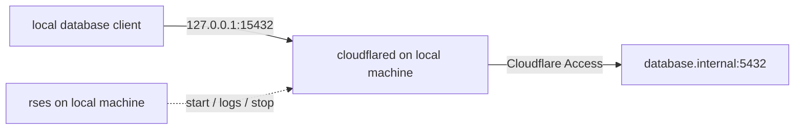

# Cloudflare Access TCP Provider

The `cloudflared-tcp` provider runs `cloudflared access tcp` as an rses
session. It opens a local TCP listener and connects it to a TCP service through
a Cloudflare Access application.

## Requirements

- Python 3 is required when rses loads the configuration.
- `cloudflared` is required while the session runs.
- The Cloudflare Access application and local authentication must already be
  configured.

`rses init` installs this directory as `providers/cloudflared-tcp/` beside the
generated `rses.yaml`. Provider code is executable code; only replace it with
code from a trusted source.

## Example

This session exposes a remote PostgreSQL service on local port `15432`:



```yaml
sessions:
  database-tunnel:
    backend: tmux
    provider: cloudflared-tcp
    group: dev
    tags: [database, tunnel]
    summary: 127.0.0.1:15432 -> database.internal:5432
    with:
      hostname: access.example.com
      target: database.internal:5432
      listen: 127.0.0.1:15432
```

```bash
rses start database-tunnel
rses logs --follow database-tunnel
rses stop database-tunnel
```

Use `backend: tmux` so `cloudflared` and its listening endpoint run on the
local machine. Fields such as `depends_on`, `stop_dependencies`, `group`, and
`tags` are standard rses session fields documented in the
[rses README](https://github.com/bnkrr/rses#readme).

## Parameters

All provider parameters belong under `with` and are required.

| Parameter | Description | Generated cloudflared argument |
| --- | --- | --- |
| `hostname` | Hostname of the Cloudflare Access application. | `--hostname` |
| `target` | TCP destination reached through the Access application, such as `database.internal:5432`. | `--destination` |
| `listen` | Local address on which `cloudflared` accepts connections, such as `127.0.0.1:15432`. | `--url` |

The provider generates the equivalent of:

```bash
cloudflared access tcp \
  --hostname access.example.com \
  --destination database.internal:5432 \
  --url 127.0.0.1:15432
```

## Runtime Behavior

Authentication and network access remain the responsibility of `cloudflared`.
Authentication failures and command output are written to the rses session
log. This provider does not add its own reconnect loop; whether and how the
command exits is determined by `cloudflared`.

Bind `listen` to `127.0.0.1` unless other machines intentionally need access.
rses manages the process lifecycle but does not configure the Cloudflare
Access application or its policies.
